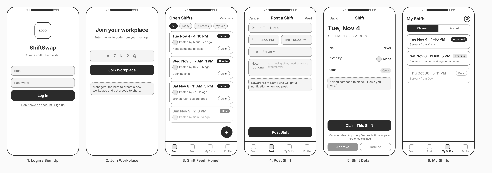
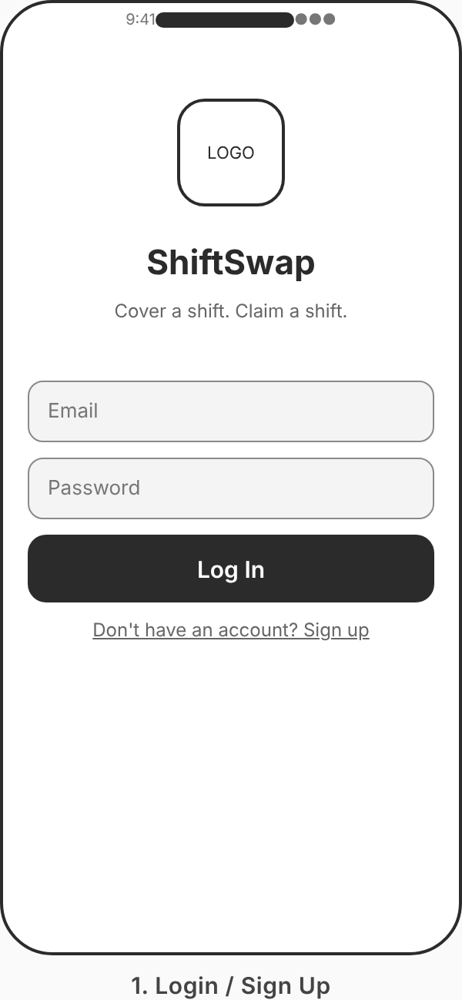
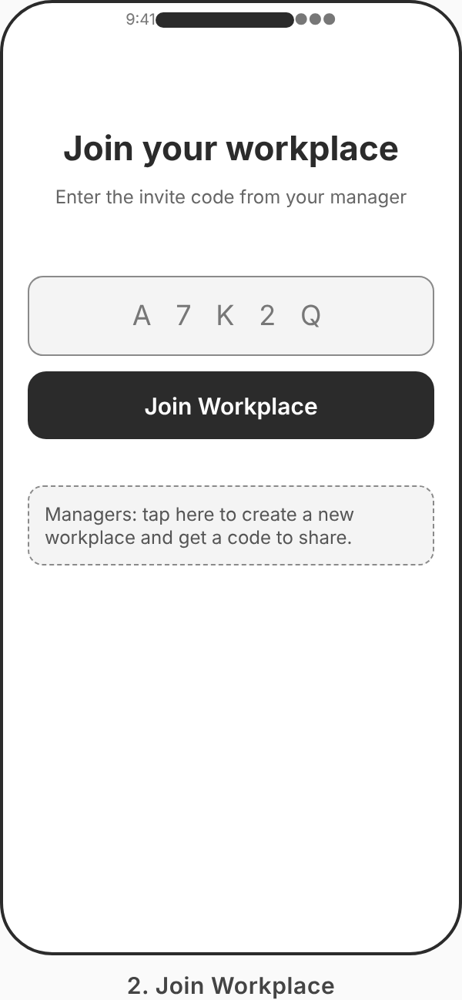
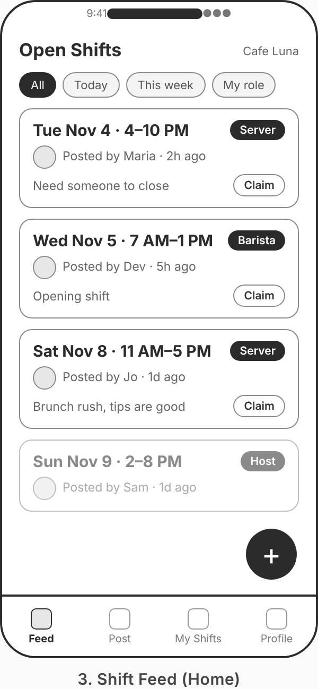
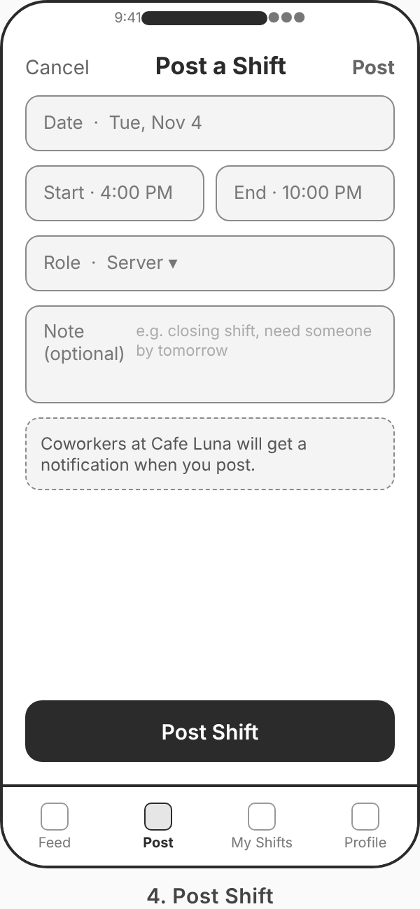
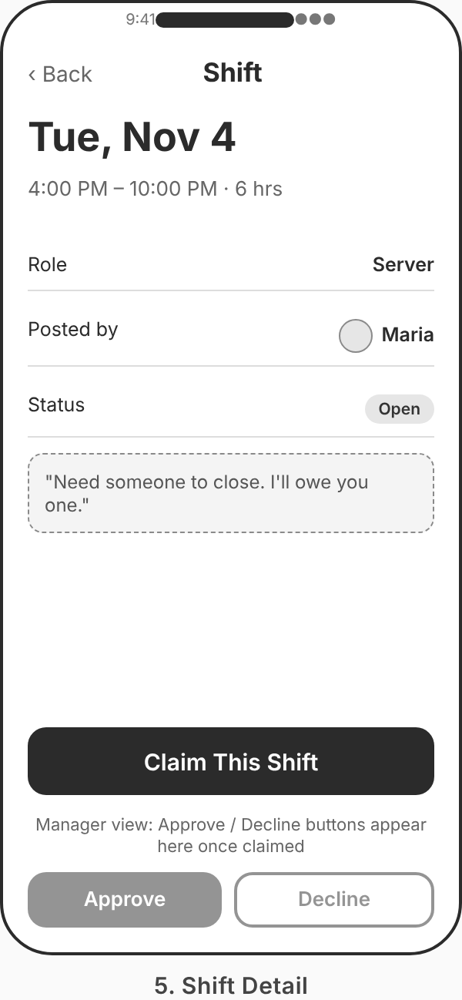
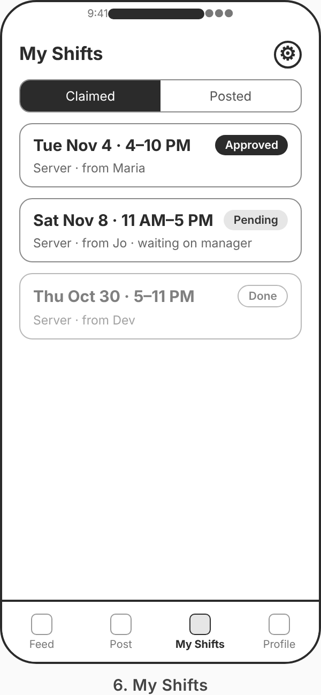

Original App Design Project
===

# ShiftSwap

**Group 7: Best Mobile App Team**
Zachri Hall, Yuliya Orlinova, Edward Del Pino, Julian Lesesne

## Table of Contents

1. [Overview](#Overview)
2. [Product Spec](#Product-Spec)
3. [Wireframes](#Wireframes)
4. [Schema](#Schema)

## Overview

### Description

ShiftSwap lets hourly workers hand off a shift they can't cover. A worker posts the shift, coworkers at the same workplace get a push notification, one of them claims it, and the manager approves it with a single tap. The app replaces the group chat that restaurants, clinics, gyms, salons and retail stores currently use for shift coverage, where posts get buried, two people claim the same shift, and the manager finds out after the fact.

### App Evaluation

- **Category:** Productivity / Workplace
- **Mobile:** Shift coverage happens away from a desk, often the same day. The app depends on push notifications to reach coworkers wherever they are and on a single-tap claim flow that works from a lock screen. Workplace location can scope the feed. This is a uniquely mobile experience, not a website in a wrapper.
- **Story:** Everyone who has worked an hourly job has either begged a group chat for coverage or scrolled past someone else begging. The value is clear in one sentence, and the pain point is one all four team members have lived.
- **Market:** Every business with hourly staff and variable schedules. Restaurants, clinics, gyms, salons, retail and hospitality employ tens of millions of hourly workers in the United States, nearly all of whom coordinate coverage informally today. A single workplace with a handful of coworkers gets full value from the app, so there is no two-sided cold-start problem.
- **Habit:** Workers open it whenever their schedule changes, which is weekly or more often for most hourly staff. Managers open it whenever a shift is posted. Both sides create and consume content, and the push notification brings people back at exactly the moment the app is useful.
- **Scope:** The MVP is three screens and one approval flow, which is well within reach for a four-person team over the remaining units. A stripped-down version with no manager approval is still useful and fully demoable. Stretch features (calendar sync, swap history, multiple workplaces) are clearly separable and can be dropped without hurting the core.

## Product Spec

### 1. User Features (Required and Optional)

**Required Features**

1. User can sign up and log in with email and password.
2. User can join a workplace using an invite code so they only see shifts from their own job.
3. User can post a shift they need covered, with date, start time, end time, role and an optional note.
4. User can view a feed of open shifts at their workplace, sorted by soonest first.
5. User can tap a shift to see its details and claim it.
6. A manager can approve or decline a claimed shift.
7. User receives a push notification when a new shift is posted at their workplace and when their claim is approved or declined.
8. User can view their own posted and claimed shifts in one place.

**Optional Features**

1. User can filter the feed by role or by day.
2. User can add an approved shift to their phone calendar.
3. Workplace shows a simple history of completed swaps.
4. User can belong to more than one workplace and switch between them.
5. Manager can see which shifts are still uncovered within 24 hours and re-post them.

### 2. Screen Archetypes

- **Login / Sign Up**
  - User can sign up and log in with email and password.
- **Join Workplace**
  - User can join a workplace using an invite code.
- **Shift Feed (Home)**
  - User can view a feed of open shifts at their workplace, sorted by soonest first.
  - User can filter the feed by role or day (optional).
- **Post Shift**
  - User can post a shift they need covered.
- **Shift Detail**
  - User can see a shift's details and claim it.
  - Manager can approve or decline a claim.
- **My Shifts**
  - User can view their own posted and claimed shifts.
- **Profile / Settings**
  - User can see their workplace, role and notification settings, and log out.

### 3. Navigation

**Tab Navigation** (Tab to Screen)

- Feed
- Post
- My Shifts
- Profile

**Flow Navigation** (Screen to Screen)

- **Login / Sign Up**
  - → Join Workplace (first launch, no workplace yet)
  - → Shift Feed (returning user)
- **Join Workplace**
  - → Shift Feed
- **Shift Feed**
  - → Shift Detail (tap a shift)
  - → Post Shift (tap the + button)
- **Post Shift**
  - → Shift Feed (after posting)
- **Shift Detail**
  - → Shift Feed (after claiming, or after manager approves/declines)
- **My Shifts**
  - → Shift Detail (tap a shift)
- **Profile / Settings**
  - → Login (log out)

## Wireframes

Low-fidelity wireframes for the six core screens.

Individual screens:

| Login | Join Workplace | Shift Feed |
|---|---|---|
|  |  |  |

| Post Shift | Shift Detail | My Shifts |
|---|---|---|
|  |  |  |

### [BONUS] Digital Wireframes & Mockups

The wireframes above are digital low-fidelity frames rendered from a shared layout spec.

### [BONUS] Interactive Prototype

To be added.

## Schema

### Models

**User**

| Property | Type | Description |
|---|---|---|
| id | String | Unique identifier |
| email | String | Login email |
| displayName | String | Name shown on posts |
| workplaceId | String | Workplace the user belongs to |
| role | String | Job role, for example "Server" or "RBT" |
| isManager | Bool | Whether the user can approve claims |

**Workplace**

| Property | Type | Description |
|---|---|---|
| id | String | Unique identifier |
| name | String | Workplace name |
| inviteCode | String | Code new members use to join |

**Shift**

| Property | Type | Description |
|---|---|---|
| id | String | Unique identifier |
| workplaceId | String | Workplace the shift belongs to |
| postedBy | String | User id of the poster |
| date | Date | Shift date |
| startTime | Date | Start time |
| endTime | Date | End time |
| role | String | Role needed |
| note | String | Optional note |
| status | String | open, claimed, approved, declined |
| claimedBy | String? | User id of the claimer |

### Networking

- **Shift Feed**
  - (Read) Query shifts where `workplaceId` matches the user's workplace and `status` is open, ordered by `date` ascending.
- **Post Shift**
  - (Create) Create a new shift document with `status = open`.
- **Shift Detail**
  - (Read) Fetch one shift by id.
  - (Update) Claim: set `status = claimed` and `claimedBy = currentUser`.
  - (Update) Manager approve/decline: set `status = approved` or `declined`.
- **My Shifts**
  - (Read) Query shifts where `postedBy` or `claimedBy` equals the current user.
- **Login / Sign Up**
  - (Create/Read) Firebase Authentication email and password.
- **Join Workplace**
  - (Read) Look up workplace by `inviteCode`.
  - (Update) Set the user's `workplaceId`.

Backend: Firebase Authentication for accounts and Cloud Firestore for workplaces and shifts, with a snapshot listener on the feed so new posts appear live. Push notifications via Firebase Cloud Messaging.
